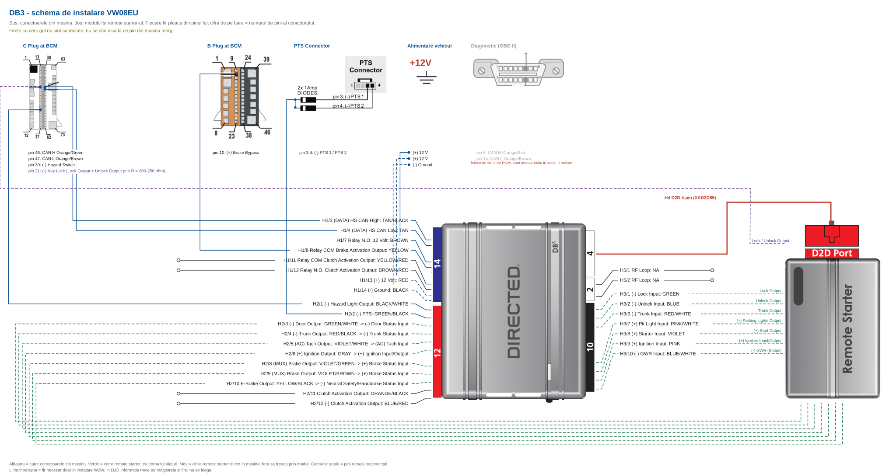

<!-- GENERAT AUTOMAT de gen_install_guide.pl -->
<!-- sursa: ../TechSheet/VW08EU_tech_sheet 2026.09.17.xlsx, foaia 'Install 40x ORI' -->
<!-- NU edita acest fisier: modifica techsheet-ul si regenereaza -->

# 403.VW08EU v1.00

**Audi / Volkswagen / Seat / Skoda (PTS and Regular Key) EU**

Platforma DB3.

## Functions compatible with this vehicle

> Lista vine din foaia `Features` a techsheet-ului, coloanele `40x D2D` / `40x W2W`.
> **ATENTIE:** foaia `Features` nu a fost inca adusa la zi pentru VW08EU - bifele de mai jos sint inca cele mostenite din sablon.

- DL-Arm Factory Security
- DL-Disarm Factory Security
- DL-Door Lock Control
- DL-Door Unlock
- DL-Trunk / Hatch Release
- PK-Universal RF Bypass- Key Req'd
- RS-RAP Shut Down (Retained ACC Power)
- RS-Tach / RPM Output
- SS-Entry Monitoring ALL Door Pins
- SS-Entry Monitoring Hood Pin
- SS-Entry Monitoring Trunk/Hatch Pin
- ST-Brake Status (foot brake)
- ST-Hand Brake Status
- ST-Ignition Status

## Vehicle connections

Coloanele `Connects To` si `Wire Location` sint specifice vehiculului si nu exista in techsheet; se completeaza din schema de cablare.

### Data 14-pin blue connector (H1)

| Conn./Pin | Module wire | Description | Connects To | Tag | Wire Location |
|---|---|---|---|---|---|
| H1/1 | LIGHT GREEN | No Connection | No Connection |  |  |
| H1/2 | VIOLET/YELLOW | No Connection | No Connection |  |  |
| H1/3 | TAN/BLACK | (DATA) HS CAN High | Vehicle | CAN Bus High | _TBD_ |
| H1/4 | TAN | (DATA) HS CAN Low | Vehicle | CAN Bus Low | _TBD_ |
| H1/5 | ORANGE/GREEN | No Connection | No Connection |  |  |
| H1/6 | ORANGE/BROWN | No Connection | No Connection |  |  |
| H1/7 | BROWN | Relay N.O. 12 Volt | Vehicle | 12 Volts | _TBD_ |
| H1/8 | YELLOW | Relay COM Brake Activation Output | Vehicle | Brake Wire | _TBD_ |
| H1/9 | ORANGE or ORANGE/YELLOW | No Connection | No Connection |  |  |
| H1/10 | ORANGE/RED | No Connection | No Connection |  |  |
| H1/11 | YELLOW/RED | Relay COM Clutch Activation Output (Manual transmission only) | Vehicle | Clutch Pedal | _TBD_ |
| H1/12 | BROWN/RED | Relay N.O. Clutch Activation Output (Manual transmission only) | Vehicle | Clutch Pedal | _TBD_ |
| H1/13 | RED | W2W Only - (+) 12 Volt | Vehicle | 12 Volts | _TBD_ |
| H1/14 | BLACK | W2W Only - (-) Ground | Vehicle | Ground | _TBD_ |

### Output 12-pin red connector (H2)

| Conn./Pin | Module wire | Description | Connects To | Tag | Wire Location |
|---|---|---|---|---|---|
| H2/1 | BLACK/WHITE | (-) Hazard Light Output | Vehicle | Hazards | _TBD_ |
| H2/2 | GREEN/BLACK | (-) PTS | Vehicle | PTS 1 | _TBD_ |
| H2/3 | GREEN/WHITE | W2W Only - (-) Door Output | Remote Starter | Door Status | _TBD_ |
| H2/4 | RED/BLACK | W2W Only - (-) Trunk Output | Remote Starter | Trunk Status | _TBD_ |
| H2/5 | VIOLET/WHITE | W2W Only - (AC) Tach Output (Connect only if RPM is not available over the data bus) | Remote Starter | Tachometer | _TBD_ |
| H2/6 | GRAY | W2W Only - (+) Ignition Output | Remote Starter | Ignition | _TBD_ |
| H2/7 | GRAY/BLACK | No Connection | No Connection |  |  |
| H2/8 | VIOLET/GREEN | W2W Only - (MUX) Brake Output (Brake status uses both pin 8 and pin 9 - connect both) | Remote Starter | Brake Wire | _TBD_ |
| H2/9 | VIOLET/BROWN | W2W Only - (MUX) Brake Output (Brake status (DAC output)) | Remote Starter | Brake Wire | _TBD_ |
| H2/10 | YELLOW/BLACK | W2W Only - E-Brake Output (Handbrake status) | Remote Starter | Parking Brake | _TBD_ |
| H2/11 | ORANGE/BLACK | Clutch Activation Output (Manual transmission only; also RAP Off after shutdown) | Vehicle | Clutch Pedal | _TBD_ |
| H2/12 | BLUE/RED | (-) Clutch Activation Output (Manual transmission only) | Vehicle | Clutch Pedal | _TBD_ |

### Input 10-pin black connector (H3)

| Conn./Pin | Module wire | Description | Connects To | Tag | Wire Location |
|---|---|---|---|---|---|
| H3/1 | GREEN | W2W Only - (-) Lock Input | Remote Starter | Power Lock | _TBD_ |
| H3/2 | BLUE | W2W Only - (-) Unlock Input | Remote Starter | Power Unlock | _TBD_ |
| H3/3 | RED/WHITE | W2W Only - (-) Trunk Input | Remote Starter | Trunk/Hatch Release | _TBD_ |
| H3/4 | WHITE/VIOLET | No Connection | No Connection |  |  |
| H3/5 | VIOLET/BLACK | No Connection | No Connection |  |  |
| H3/6 | WHITE/BLACK | No Connection | No Connection |  |  |
| H3/7 | PINK/WHITE | W2W Only - (+) Pk Light Input | Remote Starter | Parking Lights (+) | _TBD_ |
| H3/8 | VIOLET | W2W Only - (+) Starter Input | Remote Starter | Starter | _TBD_ |
| H3/9 | PINK | W2W Only - (+) Ignition Input | Remote Starter | Ignition | _TBD_ |
| H3/10 | BLUE/WHITE | W2W Only - (-) GWR Input | Remote Starter | Ground While Running Status | _TBD_ |

### RF 2-pin white connector (H5)

| Conn./Pin | Module wire | Description | Connects To | Tag | Wire Location |
|---|---|---|---|---|---|
| H5/1 | NA | RF Loop (RF loop, driven together with GWR) | External Device |  | _TBD_ |
| H5/2 | NA | RF Loop (RF loop, driven together with GWR) | External Device |  | _TBD_ |

### D2D 4-pin white connector (H4)

> Constant pe modul, nu depinde de firmware; nu apare in techsheet.

| Conn./Pin | Module wire | Description |
|---|---|---|
| H4/1 | Blue | (Data) TX |
| H4/2 | Black | (-) Ground |
| H4/3 | Green | (Data) RX |
| H4/4 | Red | (+) 12 Volt |

## Module connection diagram

> Desen generat din acelasi tech sheet ca tabelele de mai sus, deci nu poate ajunge sa le contrazica. Contine **numai firele folosite de VW08EU**.
> **Partea de vehicul lipseste intentionat:** conectorii si pinii din masina nu sint inca stabiliti. Capetele libere ale firelor se completeaza cand se face schema de cablare.

## Feature and option list

See Admin/Web

---

Generat din `VW08EU_tech_sheet 2026.09.17.xlsx`, foaia `Install 40x ORI`.
