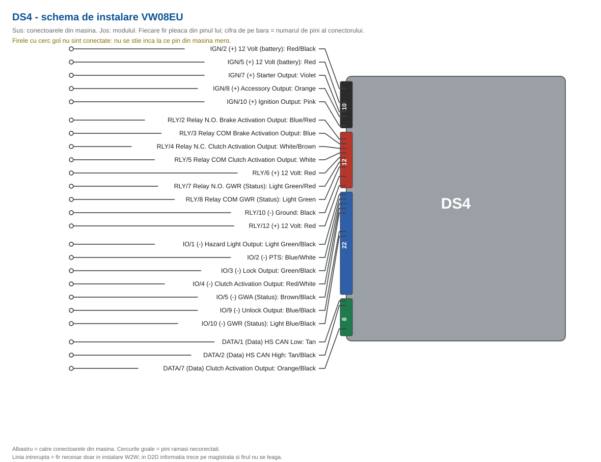

<!-- GENERAT AUTOMAT de gen_install_guide.pl -->
<!-- sursa: ../TechSheet/VW08EU_tech_sheet 2026.09.17.xlsx, foaia 'Install 933' -->
<!-- NU edita acest fisier: modifica techsheet-ul si regenereaza -->

# 933.VW08EU v1.00

**Audi / Volkswagen / Seat / Skoda (PTS and Regular Key) EU**

Platforma DS4.

## Functions compatible with this vehicle

> Lista vine din foaia `Features` a techsheet-ului, coloanele `933 D2D`.
> **ATENTIE:** foaia `Features` nu a fost inca adusa la zi pentru VW08EU - bifele de mai jos sint inca cele mostenite din sablon.

- DL-Arm Factory Security
- DL-Disarm Factory Security
- DL-Trunk / Hatch Release
- PK-Universal RF Bypass- Key Req'd
- RS-3x LOCK START (Start control using OEM Remote)
- RS-3x LOCK STOP (Start control using OEM Remote)
- RS-RAP Shut Down (Retained ACC Power)
- RS-Tach / RPM Output
- SS-Entry Monitoring ALL Door Pins
- SS-Entry Monitoring Hood Pin
- SS-Entry Monitoring Trunk/Hatch Pin
- ST-Brake Status (foot brake)
- ST-Hand Brake Status
- ST-Ignition Status

## Vehicle connections

Coloanele `Connects To` si `Wire Location` sint specifice vehiculului si nu exista in techsheet; se completeaza din schema de cablare.

### 10-pin main ignition harness

| Conn./Pin | Module wire | Description | Connects To | Tag | Wire Location |
|---|---|---|---|---|---|
| IGN/1 | N/A | No Connection | No Connection |  |  |
| IGN/2 | Red/Black | (+) 12 Volt (battery) | Vehicle | 12 Volts | _TBD_ |
| IGN/3 | Pink/Black | No Connection | No Connection |  |  |
| IGN/4 | Pink/White | No Connection | No Connection |  |  |
| IGN/5 | Red | (+) 12 Volt (battery) | Vehicle | 12 Volts | _TBD_ |
| IGN/6 | Green | No Connection | No Connection |  |  |
| IGN/7 | Violet | (+) Starter Output | Vehicle | Starter | _TBD_ |
| IGN/8 | Orange | (+) Accessory Output | Vehicle | Accessory | _TBD_ |
| IGN/9 | Red/White | No Connection | No Connection |  |  |
| IGN/10 | Pink | (+) Ignition Output | Vehicle | Ignition | _TBD_ |

### 12-pin relay harness

| Conn./Pin | Module wire | Description | Connects To | Tag | Wire Location |
|---|---|---|---|---|---|
| RLY/1 | Blue/White | No Connection | No Connection |  |  |
| RLY/2 | Blue/Red | Relay N.O. Brake Activation Output | Vehicle | Brake Wire | _TBD_ |
| RLY/3 | Blue | Relay COM Brake Activation Output | Vehicle | Brake Wire | _TBD_ |
| RLY/4 | White/Brown | Relay N.C. Clutch Activation Output (Manual transmission only) | Vehicle | Clutch Pedal | _TBD_ |
| RLY/5 | White | Relay COM Clutch Activation Output (Manual transmission only) | Vehicle | Clutch Pedal | _TBD_ |
| RLY/6 | Red | (+) 12 Volt | Vehicle | 12 Volts | _TBD_ |
| RLY/7 | Light Green/Red | Relay N.O. GWR (Status) | External Device | Ground While Running Status | _TBD_ |
| RLY/8 | Light Green | Relay COM GWR (Status) | External Device | Ground While Running Status | _TBD_ |
| RLY/9 | Light Green/White | No Connection | No Connection |  |  |
| RLY/10 | Black | (-) Ground | Vehicle | Ground | _TBD_ |
| RLY/11 | White | No Connection | No Connection |  |  |
| RLY/12 | Red | (+) 12 Volt | Vehicle | 12 Volts | _TBD_ |

### 22-pin input/output harness

| Conn./Pin | Module wire | Description | Connects To | Tag | Wire Location |
|---|---|---|---|---|---|
| IO/1 | Light Green/Black | (-) Hazard Light Output | Vehicle | Hazards | _TBD_ |
| IO/2 | Blue/White | (-) PTS | Vehicle | PTS 1 | _TBD_ |
| IO/3 | Green/Black | (-) Lock Output | Vehicle | Power Lock | _TBD_ |
| IO/4 | Red/White | (-) Clutch Activation Output (Manual transmission only) | Vehicle | Clutch Pedal | _TBD_ |
| IO/5 | Brown/Black | (-) GWA (Status) | External Device | Ground While Arming Status | _TBD_ |
| IO/6 | Brown/White | No Connection | No Connection |  |  |
| IO/7 | White | No Connection | No Connection |  |  |
| IO/8 | Violet/Black | No Connection | No Connection |  |  |
| IO/9 | Blue/Black | (-) Unlock Output | Vehicle | Power Unlock | _TBD_ |
| IO/10 | Light Blue/Black | (-) GWR (Status) | External Device | Ground While Running Status | _TBD_ |
| IO/11 | Brown/Red | No Connection | No Connection |  |  |
| IO/12 | Pink | No Connection | No Connection |  |  |
| IO/13 | Violet | No Connection | No Connection |  |  |
| IO/14 | Brown | No Connection | No Connection |  |  |
| IO/15 | White/Blue | No Connection | No Connection |  |  |
| IO/16 | Red/Blue | No Connection | No Connection |  |  |
| IO/17 | Black/White | No Connection | No Connection |  |  |
| IO/18 | Orange/Black | No Connection | No Connection |  |  |
| IO/19 | Blue | No Connection | No Connection |  |  |
| IO/20 | Green | No Connection | No Connection |  |  |
| IO/21 | Gray | No Connection | No Connection |  |  |
| IO/22 | Violet/White | No Connection | No Connection |  |  |

### 8-pin data harness

| Conn./Pin | Module wire | Description | Connects To | Tag | Wire Location |
|---|---|---|---|---|---|
| DATA/1 | Tan | (Data) HS CAN Low | Vehicle | CAN Bus Low | _TBD_ |
| DATA/2 | Tan/Black | (Data) HS CAN High | Vehicle | CAN Bus High | _TBD_ |
| DATA/3 | Orange/Brown | No Connection | No Connection |  |  |
| DATA/4 | Orange/Green | No Connection | No Connection |  |  |
| DATA/5 | Light Green | No Connection | No Connection |  |  |
| DATA/6 | Violet/Brown | No Connection (Brake status (DAC) is driven by the FW, but on DS4 there is no external remote starter to receive it) | No Connection |  |  |
| DATA/7 | Orange/Black | (Data) Clutch Activation Output (Manual transmission only) | Vehicle | Clutch Pedal | _TBD_ |
| DATA/8 | Yellow/Black | No Connection | No Connection |  |  |

### Fuse panel

| Fuse | Description | Connects To | Note |
|---|---|---|---|
| IGN (20A) | No Connection | No Connection |  |
| FLEX RLY (20A) | No Connection | No Connection |  |
| ACC & START (30A) | No Connection | No Connection |  |
| RLY3 PK LIGHT (15A) | No Connection | No Connection |  |
| MAIN (5A) | 12 Volt | Mandatory | MODULE POWER |

## Module connection diagram

> Desen generat din acelasi tech sheet ca tabelele de mai sus, deci nu poate ajunge sa le contrazica. Contine **numai firele folosite de VW08EU**.
> **Partea de vehicul lipseste intentionat:** conectorii si pinii din masina nu sint inca stabiliti. Capetele libere ale firelor se completeaza cand se face schema de cablare.

## Feature and option list

See Admin/Web

---

Generat din `VW08EU_tech_sheet 2026.09.17.xlsx`, foaia `Install 933`.
